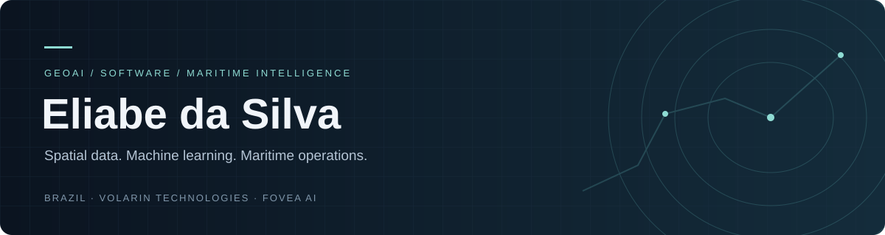

 
<strong>Part of the Fovea AI project at Volarin Technologies.</strong>
 
Geospatial intelligence · Software development · Machine learning

 

## About me

I'm Eliabe, based in Brazil. I'm part of **Fovea AI**, a project at **Volarin Technologies** focused on geospatial intelligence for maritime operations.

My current work involves Python, PostgreSQL and PostGIS, with early tests around vessel positions, port areas and simulated operational data. I'm also exploring the data preparation, model training and evaluation needed for future machine learning experiments.

 

## Languages & development

**Current foundation**

**Learning and evaluating for future project work**

**Web interface foundations**

Python and SQL support the current data work. TypeScript, JavaScript and Bash are learning directions for web interfaces, services and development automation; HTML and CSS support interface structure and styling.

 

## Data, GeoAI & model training

| Layer | Foundation and exploration |
| :--- | :--- |
| **Spatial database** | PostgreSQL · PostGIS — current foundation |
| **Data processing** | pandas · NumPy — upcoming experiments |
| **Geospatial tooling** | GeoPandas · Shapely — upcoming experiments |
| **Machine learning** | scikit-learn · feature engineering · anomaly detection |
| **Deep learning** | PyTorch · neural-network training — learning direction |
| **Model evaluation** | Baselines · time-based validation · precision and recall · error analysis |
| **Applications** | FastAPI · React · REST APIs — under evaluation |
| **Development workflow** | Git — current foundation; Docker — under evaluation |

 

## Project / Fovea AI

> Geospatial intelligence for understanding maritime activity.

I'm contributing to the project's early technical foundations. The initial focus is vessel monitoring and port-area analysis, with machine learning experiments planned as the data foundation develops.

| Focus | Work and direction |
| :--- | :--- |
| **Maritime data** | Vessel positions and simulated tracking updates |
| **Spatial analysis** | Geographic zones, port areas and spatial relationships |
| **Trajectory analysis** | Movement patterns and tracking gaps |
| **AI experiments** | Dataset preparation, feature engineering and model training |
| **Operational intelligence** | Exploring how analysis can support maritime workflows |

 

## What you'll find here

**Geospatial experiments**  
Small Python and PostGIS examples with reproducible steps.

**Data & machine learning**  
Selected experiments documenting datasets, training methods, evaluation and limitations.

**Development notes**  
My technical contributions, implementation choices and lessons from testing.

Fovea AI is in early development. Public examples will identify simulated data and distinguish working features from planned experiments.

---

<strong>Let's exchange ideas.</strong> 
Geospatial technology · Software engineering · Machine learning · Maritime operations

